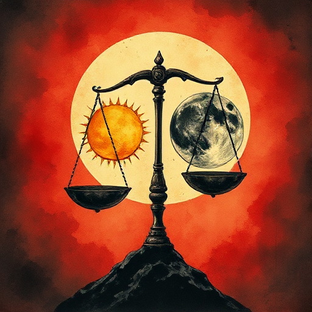

## Moralische Prämisse

Ein präziser Satz, der das Thema als kausale Formel ausdrückt: »[Laster] führt zu [Niederlage], [Tugend] führt zu [Sieg].«

### Funktion

Gibt dem Autor einen Test für jede Szene: Trägt diese Szene zur moralischen Prämisse bei? Verhindert thematische Inkohärenz.

### Anwendung

Lässt sich das Thema meiner Geschichte auf eine Prämisse komprimieren? Welche Figur verkörpert die positive, welche die negative Seite?

### Beispiele

- »Gier führt zu Zerstörung, Großzügigkeit zur Verbindung« (A Christmas Carol)
- »Hochmut führt zum Fall« (Macbeth)

### Passt zu

- [Thematische Frage](thematische-frage.md)
- [Gegen-Thema](gegen-thema.md)

### Quellen

- Die moralische Prämisse, Stanley D. Williams

### Bild

