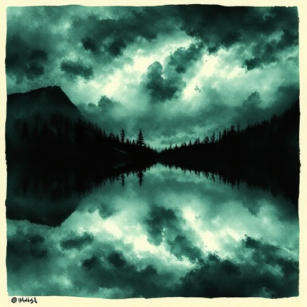

## Naturspiegelung

Die Natur oder Umgebung spiegelt den emotionalen Zustand einer Figur oder das dramatische Gewicht einer Szene wider.

### Funktion

Verstärkt emotionale Wirkung durch atmosphärische Resonanz ohne explizite Beschreibung von Gefühlen.

### Anwendung

Welches Wetterelement oder Naturdetail könnte den inneren Zustand meiner Figur symbolisch verstärken – ohne klischeehaft zu sein?

### Beispiele

- Sturm in Shakespeares Tragödien (Lear, Macbeth)
- Sonnenschein nach Scrooges Wandlung (A Christmas Carol)

### Vorsicht

Zu direkte Entsprechung (Gewitter = böse, Sonne = gut) wirkt klischeehaft.

### Passt zu

- [Setting als Charakter](setting-als-charakter.md)
- [Leitmotiv](leitmotiv.md)

### Bild

