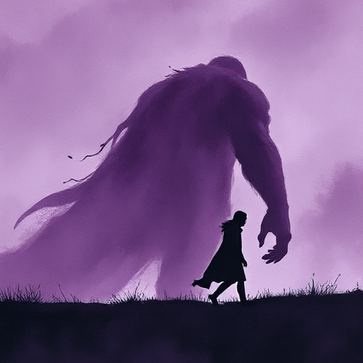

## Negativer Bogen

Eine Figur beginnt mit einer falschen Überzeugung und wird durch die Handlung tiefer in diese Lüge hineingezogen, bis sie scheitert oder fällt.

### Funktion

Erzeugt Tragödie und Sozialkritik. Der Leser sieht das Scheitern kommen und ist trotzdem gefesselt. Das Thema wird durch das Scheitern enthüllt.

### Anwendung

An welchem Punkt hat meine Figur die letzte Möglichkeit, sich anders zu entscheiden? Welche Szene markiert diesen unumkehrbaren Wendepunkt?

### Beispiele

- Macbeth (Shakespeare)
- Walter White (Breaking Bad)
- Anakin Skywalker (Star Wars)

### Passt zu

- [Tragischer Fehler](tragischer-fehler.md)
- [Figur vs. sich selbst](figur-vs-sich-selbst.md)
- [Freytags Pyramide](freytags-pyramide.md)

### Bild

