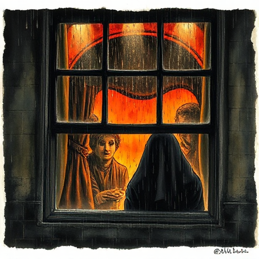

## Neutraler Erzähler

Ein Erzähler, der ausschließlich Beobachtbares wie Handlungen, Dialoge und Gesten beschreibt, ohne Zugang zu Gedanken oder Gefühlen einer Figur. Auch bekannt als dramatischer oder Kamera-Erzähler.

### Funktion

Zwingt den Leser zur eigenen Interpretation von Emotionen, erzeugt Kälte und Distanz als Stilmittel und lässt dem Leser viel Raum für eigene Deutung.

### Anwendung

Was müssen meine Figuren tun und sagen, damit ihr innerer Zustand ohne jede Innenperspektive dennoch erkennbar ist?

### Beispiele

- Hills Like White Elephants (Hemingway – kein einziger innerer Gedanke)
- Dashiell Hammetts Detektivprosa
- L'Étranger (Camus – überwiegend)

### Vorsicht

Konsequenter Verzicht auf Innenperspektive kann emotionale Distanz erzeugen, die Leser nicht investiert bleiben lässt.

### Passt zu

- [Erzähldistanz](erzaehldistanz.md)
- [Tiefer personaler Erzähler (Deep POV)](tiefer-personaler-erzaehler.md)
- [Subtext](subtext.md)

### Bild

