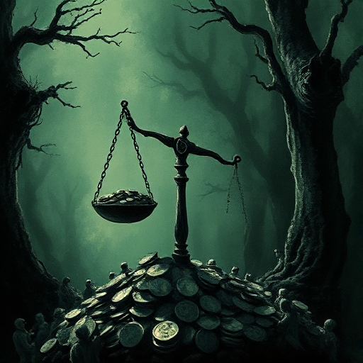

## Ökonomie & Macht

Wer hat in der fiktiven Welt welche Ressourcen und welchen Einfluss? Ökonomische Strukturen bestimmen, wer handeln kann und wer nicht.

### Funktion

Gibt Konflikten eine materielle Basis und verhindert, dass die Handlung im Luftleeren schwebt. Macht Schurken glaubwürdig durch reale Interessenlagen.

### Anwendung

Was wäre, wenn meine Figur kein Geld, keinen Status oder keine Verbündeten hätte? Was kann sie sich wirklich leisten?

### Beispiele

- Die Spice-Ökonomie in Dune
- Machtstrukturen in Game of Thrones
- Klassengesellschaft bei Dickens

### Passt zu

- [Figur vs. Gesellschaft](figur-vs-gesellschaft.md)
- [Kultur & Gesellschaft](kultur-gesellschaft.md)
- [Der Herrscher](der-herrscher.md)

### Bild

