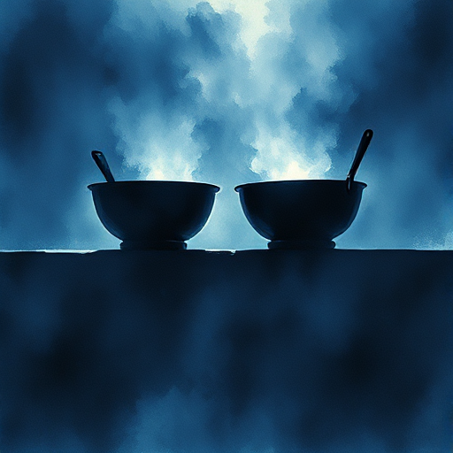

## Poetische Gerechtigkeit

Figuren erhalten am Ende der Geschichte das, was sie durch ihre Handlungen verdienen – Tugend wird belohnt, Laster bestraft.

### Funktion

Gibt dem Leser Genugtuung und unterstreicht das moralische Weltbild der Geschichte. Fehlt sie bewusst, entsteht Tragödie oder Sozialkritik.

### Anwendung

Ergibt die Schlusssituation meiner Figuren organisch aus ihren früheren Entscheidungen – oder kommt sie von außen?

### Beispiele

- Gatsby (Der große Gatsby)
- Walter White (Breaking Bad)
- Schurken in Märchen

### Vorsicht

Zu mechanisch angewandte poetische Gerechtigkeit wirkt naiv; sie muss aus der Logik der Geschichte folgen.

### Passt zu

- [Moralische Prämisse](moralische-praemisse.md)
- [Negativer Bogen](negativer-bogen.md)

### Bild

