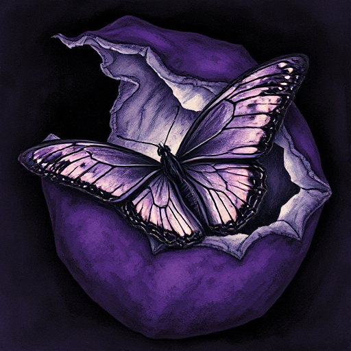

## Positiver Wandlungsbogen

Eine Figur beginnt mit einer falschen Überzeugung oder Schwäche und wächst durch die Handlung zu einer Wahrheit, die sie am Anfang nicht erkennen konnte.

### Funktion

Wirkt emotional am stärksten, weil der Leser die innere Reise ebenso verfolgt wie die äußere. Im Bogen zeigt sich das Thema der Geschichte.

### Anwendung

Was glaubt meine Figur zu Beginn fälschlicherweise über sich, andere oder die Welt? Welche Szene zwingt sie, diese Überzeugung aufzugeben?

### Beispiele

- Ebenezer Scrooge (A Christmas Carol)
- Elizabeth Bennet (Pride and Prejudice)
- Tony Stark (Iron Man)
- Simba (The Lion King)

### Passt zu

- [Die Lüge der Figur](die-luege-der-figur.md)
- [Wunsch vs. Bedürfnis](wunsch-vs-beduerfnis.md)
- [Die Unschuldige](die-unschuldige.md)

### Quellen

- The Emotional Craft of Fiction, Donald Maass

### Bild

