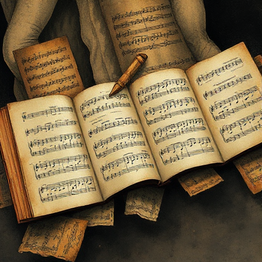

## Prosa-Rhythmus

Die bewusste Steuerung von Satzlänge, Syntax-Komplexität und Klang zur Erzeugung von Tempo, Stimmung und emotionaler Intensität. Gemeint ist das Pacing auf Wortebene, abgegrenzt vom dramatischen Beat auf Handlungsebene.

### Funktion

Kurze Sätze beschleunigen, lange verlangsamen. Harte Konsonanten erzeugen Schärfe, weiche Vokale Fluss. Der Satz selbst wird zum Pacing-Werkzeug.

### Anwendung

Lies diesen Absatz laut vor. Entsprechen Klang und Tempo dem emotionalen Inhalt der Szene?

### Beispiele

- Cormac McCarthys Kurzsätze in No Country for Old Men
- Prousts Endlossätze in Auf der Suche nach der verlorenen Zeit
- Hemingways parataktische Einfachheit

### Vorsicht

Einheitlicher Rhythmus über viele Seiten wirkt einschläfernd. Variation ist das Ziel.

### Passt zu

- [Der Beat](der-beat.md)
- [Stimmung](stimmung.md)
- [Ton](ton.md)

### Bild

