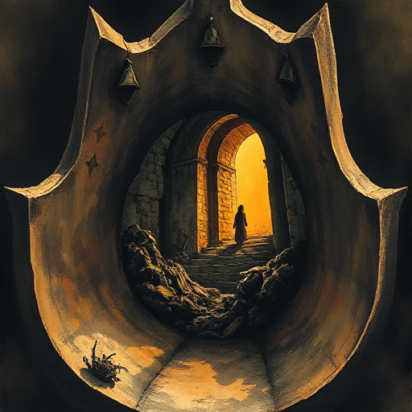

## Rahmenerzählung

Eine äußere Geschichte umschließt die eigentliche innere Erzählung. Ein Erzähler in der Rahmenhandlung berichtet von vergangenen Ereignissen.

### Funktion

Erzeugt Distanz und Kommentar, macht Auslassungen glaubwürdig, kann Spannung durch das Wissen aufbauen, dass der Erzähler überlebt hat.

### Anwendung

Was weiß mein Rahmenerzähler schon vom Ende der Geschichte? Wie färbt dieses Wissen implizit seine Erzählung?

### Beispiele

- Frankenstein (Shelley – Briefe)
- Wuthering Heights (Brontë)
- The Princess Bride
- The Hobbit

### Warnung

Ein Rahmen, der irrelevant für das Thema ist, verwirrt mehr als er hilft.

### Passt zu

- [Rückblende](rueckblende.md)
- [Unzuverlässiger Erzähler](unzuverlaessiger-erzaehler.md)

### Bild

