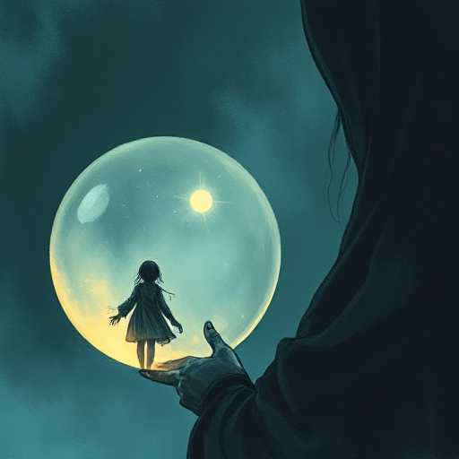

## Rückblende

Die Handlung wird unterbrochen, um einen vergangenen Moment direkt zu zeigen oder zu erleben, der das Verständnis der aktuellen Situation vertieft.

### Funktion

Enthüllt Hintergründe emotional statt als trockene Erklärung, gibt Figuren Tiefe und kann Plottwists vorbereiten.

### Anwendung

Welche Information über die Vergangenheit meiner Figur verändert die Bedeutung einer aktuellen Szene grundlegend? Wann ist der emotionalste Moment, sie zu enthüllen?

### Beispiele

- Citizen Kane (Struktur fast nur Rückblenden)
- Atonement (McEwan)
- Lost (TV-Serie)

### Vorsicht

Zu frühe Rückblenden können die Spannung der Gegenwart brechen, bevor sie aufgebaut ist.

### Passt zu

- [In Medias Res](in-medias-res.md)
- [Rahmenerzählung](rahmenerzaehlung.md)

### Bild

