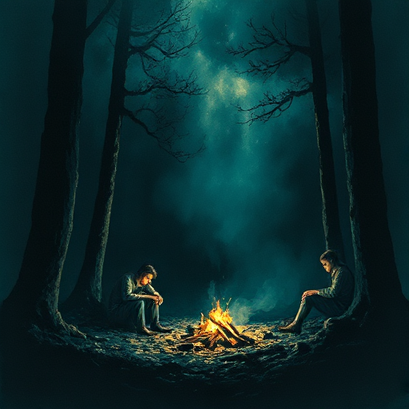

## Ruhepause

Eine Szene oder ein Kapitel, das nach intensiver Spannung emotionale Entlastung bietet: Humor, Freude, Ruhe, Verbindung zwischen Figuren.

### Funktion

Steuert das Pacing und verhindert, dass Dauerspannung den Leser abstumpft. Macht die nächste Eskalation wirksamer.

### Anwendung

Welcher Moment nach einer Klimax-Szene ermöglicht es meinen Figuren und dem Leser, kurz zu atmen? Was kann diese Pause trotzdem für den Plot leisten?

### Beispiele

- Sam & Frodos Gespräch über Geschichten (The Lord of the Rings)
- Lagerfeuernächte in Abenteuerromanen

### Vorsicht

Eine Ruhepause, die zu lang ist, tötet die aufgebaute Spannung.

### Passt zu

- [Cliffhanger](cliffhanger.md)
- [Scene & Sequel](scene-sequel.md)

### Bild

