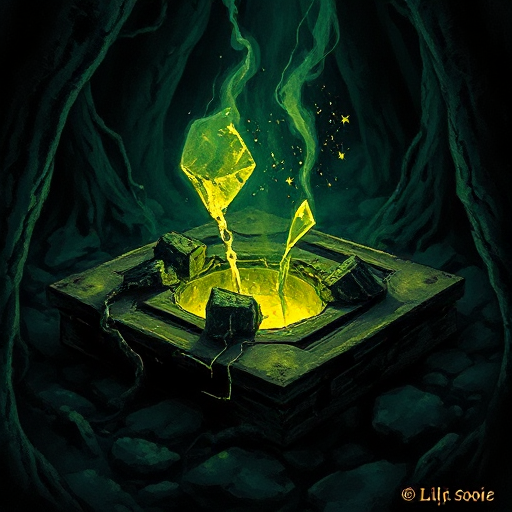

## Sandersons Zweites Gesetz

Schwächen und Grenzen eines magischen Systems sind interessanter als seine Stärken. Die Einschränkungen erzeugen Konflikt und Spannung.

### Funktion

Verhindert allmächtige Figuren, erzeugt Dilemma durch Ressourcenknappheit und zwingt den Autor zu kreativem Problemlösen innerhalb des Systems.

### Anwendung

Was kann meine Figur mit ihrer besonderen Fähigkeit nicht tun? Macht genau diese Einschränkung die Geschichte spannender?

### Beispiele

- Kosten der Allomantik in Mistborn
- Blutmagie in Fullmetal Alchemist

### Passt zu

- [Sandersons Erstes Gesetz](sandersons-erstes-gesetz.md)
- [Tragischer Fehler](tragischer-fehler.md)
- [Sandersons Drittes Gesetz](sandersons-drittes-gesetz.md)

### Quellen

- Sandersons Gesetze der Magie, Brandon Sanderson

### Bild

