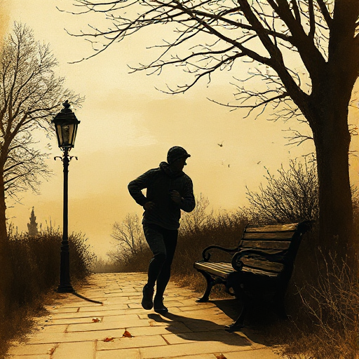

## Scene & Sequel

Auf jede Szene (Scene) aus Ziel, Konflikt und Desaster folgt eine Reaktionsphase (Sequel) aus Gefühl, Dilemma und Entscheidung, bevor die nächste Szene beginnt.

### Funktion

Gibt Lesern Zeit zur emotionalen Verarbeitung und verankert jede Szene in der inneren Logik der Figur, bevor sie wieder handelt. Als Try-Fail-Zyklus über mehrere Szenen entsteht eine eskalierende Folge aus Scheitern und neuer Entscheidung.

### Anwendung

Was entscheidet meine Figur am Ende der Reaktionsphase, das die nächste Szene mit einem neuen, konkreten Ziel startet?

### Beispiele

- Lee Child (Jack Reacher-Serie als Musterbeispiel für klare Scene-Sequel-Struktur)
- Genre-Fiction allgemein

### Passt zu

- [Szenenziel & Hindernisse](szenenziel-hindernisse.md)
- [Innere vs. äußere Reise](innere-vs-aeussere-reise.md)

### Quellen

- Techniques of the Selling Writer, Dwight Swain

### Bild

