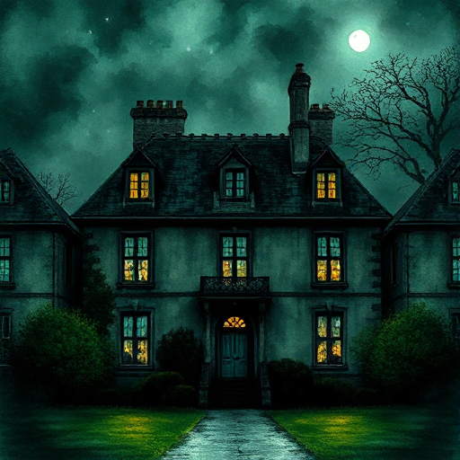

## Setting als Charakter

Ein Ort in der Geschichte besitzt eine so ausgeprägte, konsistente Atmosphäre, dass er wie eine eigenständige Figur in der Geschichte wirkt.

### Funktion

Macht die Welt lebendig und bedeutungsgeladen. Das Setting schließt das Zeitkolorit ein, also die historische oder zeitliche Atmosphäre, die durch Epochen-Details entsteht. Es kommentiert Figuren und Thema, ohne explizit zu werden.

### Anwendung

Welche drei konsistenten Eigenschaften hat mein Schauplatz? Wie verändert er sich, wenn sich die emotionale Lage meiner Figur verändert?

### Beispiele

- Manderley in Rebecca (Du Maurier)
- Hogwarts (Harry Potter)
- The Haunting of Hill House (Shirley Jackson)
- Gotham City

### Passt zu

- [Naturspiegelung](naturspiegelung.md)
- [Stimmung](stimmung.md)

### Bild

