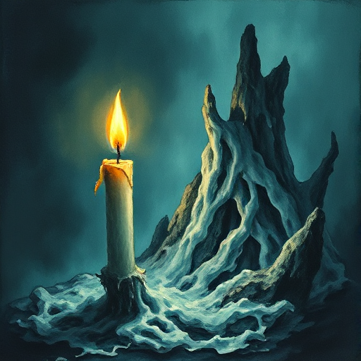

## Slow Burn

Spannung, Konflikte oder Beziehungen entwickeln sich über einen langen Zeitraum sehr graduell und subtil, bevor sie sich entladen.

### Funktion

Bindet den Leser stark, weil er lange auf die Auflösung wartet. Besonders wirksam für Romantik, Thriller und psychologische Dramen.

### Anwendung

Was ist die kleinste Eskalation, die ich pro Kapitel einbauen kann, damit mein Slow Burn voranschreitet ohne seinen Reiz zu verlieren?

### Beispiele

- Elizabeth & Darcy (Pride and Prejudice)
- Better Call Saul (Transformation zu Saul)

### Warnung

Ein Slow Burn ohne regelmäßige kleine Eskalationen stagniert und verliert den Leser.

### Passt zu

- [Enemies to Lovers](enemies-to-lovers.md)
- [Unterschwelliger Konflikt](unterschwelliger-konflikt.md)
- [Dreiecksbeziehung](dreiecksbeziehung.md)

### Bild

