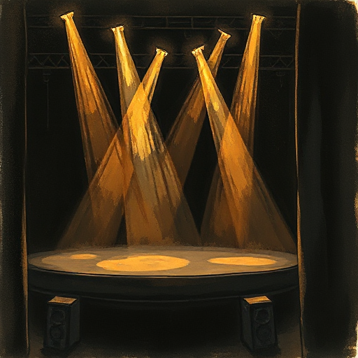

## Spät rein / früh raus

Beginne jede Szene so spät wie möglich (kurz vor dem entscheidenden Moment) und beende sie so früh wie möglich (kurz nach dem Wendepunkt).

### Funktion

Maximiert Pacing, eliminiert unnötige Warm-up-Dialoge und überflüssige Abwicklungen nach der eigentlichen Szene.

### Anwendung

Wo beginnt meine Szene wirklich? Kann ich die ersten zwei Absätze streichen? Gibt es einen Absatz zu viel nach dem Turn?

### Beispiele

- Goldstandard in Drehbüchern
- Ratschlag in Stephen Kings On Writing

### Passt zu

- [Wendepunkt der Szene](wendepunkt-der-szene.md)
- [Doppelfunktion der Szene](doppelfunktion-der-szene.md)

### Quellen

- Story, Robert McKee
- On Writing, Stephen King

### Bild

