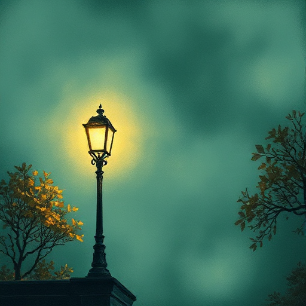

## Stimmung

Die emotionale Atmosphäre, die eine Szene oder das gesamte Werk beim Leser erzeugt, etwa Unbehagen, Melancholie, Aufregung oder Geborgenheit.

### Funktion

Schafft den emotionalen Kontext, in dem der Leser die Handlung erlebt. Stimmung entsteht durch die Summe aller Stilmittel.

### Anwendung

Welche drei spezifischen Sinneseindrücke (Klang, Geruch, Licht) kann ich einbauen, um die gewünschte Stimmung dieser Szene herzustellen?

### Beispiele

- Apokalyptische Dichte in The Road (McCarthy)
- beengende Klaustrophobie in Kafka
- spielerische Leichtigkeit in Wodehouse

### Passt zu

- [Ton](ton.md)
- [Setting als Charakter](setting-als-charakter.md)

### Bild

