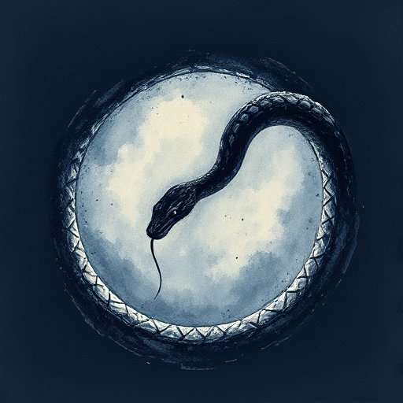

## Story Circle

Eine vereinfachte Heldenreise in acht Schritten, die den Zyklus von Komfort, Wunsch, Fremdheit, Erlangung, Bezahlung und Rückkehr beschreibt.

### Funktion

Eignet sich besonders für Episodenformate und Kurzgeschichten und macht die emotionale Logik der Heldenreise sehr greifbar.

### Anwendung

Was bringt meine Figur am Ende jedes Kapitels oder jeder Szene verändert zurück in ihren Ausgangszustand?

### Beispiele

- Rick and Morty (Harmon nutzt ihn explizit)
- Community
- Breaking Bad

### Passt zu

- [Die Heldenreise](die-heldenreise.md)
- [Scene & Sequel](scene-sequel.md)

### Quellen

- Channel 101, Dan Harmon

### Bild

