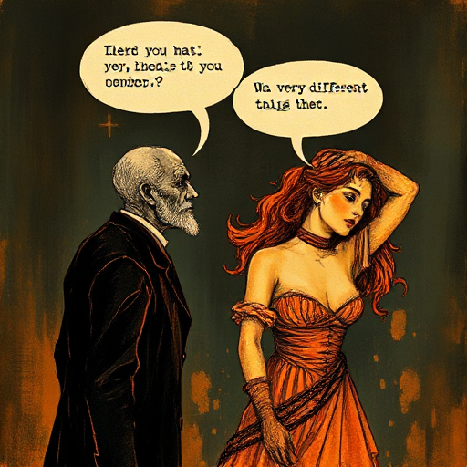

## Subtext

Was Figuren wirklich meinen, fühlen oder wollen, wird nicht explizit gesagt, sondern schwingt unter der Oberfläche des gesprochenen Textes mit.

### Funktion

Macht Dialog schichtreich und glaubwürdig, weil echte Menschen selten direkt aussprechen, was sie wirklich wollen.

### Anwendung

Was will jede Figur in diesem Dialog wirklich, und was sagt sie stattdessen? Sind diese zwei Dinge wirklich verschieden?

### Beispiele

- Der Abschiedsdialog in Casablanca
- fast jede Szene in Harold Pinters Stücken
- Szene im Café in Lost in Translation

### Vorsicht

Zu viel Subtext wirkt undurchdringlich. Zu direkte, unverblümte Aussagen (»on the nose«) wirken unnatürlich. Beide Extreme kosten Glaubwürdigkeit.

### Passt zu

- [Unterschwelliger Konflikt](unterschwelliger-konflikt.md)
- [Das Ungesagte](das-ungesagte.md)

### Bild

