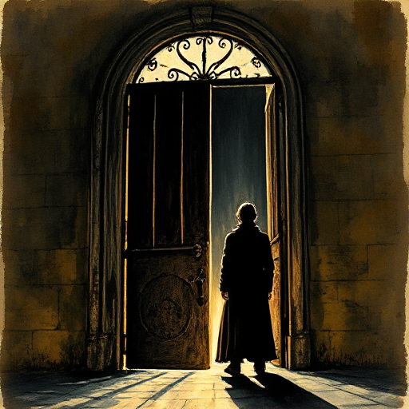

## Szenenziel & Hindernisse

Jede Szene braucht ein konkretes Ziel der Hauptfigur und ein echtes Hindernis, das das Erreichen dieses Ziels gefährdet.

### Funktion

Verhindert Szenen ohne dramatischen Zweck und stellt sicher, dass jede Szene Spannung trägt.

### Anwendung

Was will meine POV-Figur in dieser Szene? Wer oder was verhindert es? Kann das Ergebnis schlimmer werden als erwartet?

### Beispiele

- Anwendbar auf jede gut konstruierte Szene
- Grundlage in fast allen Struktur-Lehrbüchern

### Passt zu

- [Scene & Sequel](scene-sequel.md)
- [Wendepunkt der Szene](wendepunkt-der-szene.md)
- [Einsätze (Stakes)](einsaetze.md)

### Bild

