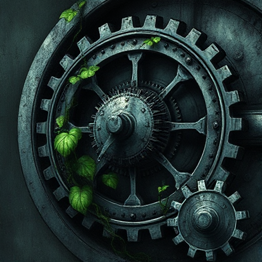

## Technologische Paradigmen

Das technologische Niveau einer Welt bestimmt, welche Konflikte, Lösungen und Machtverhältnisse existieren können.

### Funktion

Setzt die Grenzen des Möglichen in einer Welt und erzeugt charakteristische Spannungen, z.B. Mensch vs. Maschine oder Tradition vs. Innovation.

### Anwendung

Welche Technologie in meiner Welt verändert grundlegend, was Macht bedeutet? Wer hat Zugang zu ihr?

### Beispiele

- Dampfmaschinen in Steampunk-Romanen
- KI in Blade Runner / Neuromancer (Gibson)

### Passt zu

- [Figur vs. Technologie](figur-vs-technologie.md)
- [Hard Magic System](hard-magic-system.md)

### Bild

