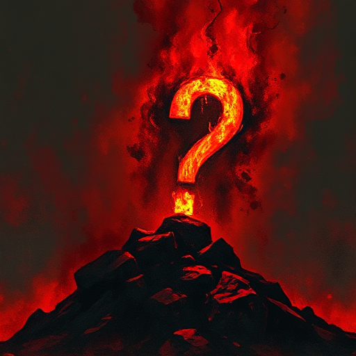

## Thematische Frage

Die zentrale moralische, philosophische oder emotionale Frage, die die Geschichte stellt und deren Antwort sie durch Handlung und Figuren ausarbeitet.

### Funktion

Gibt der Geschichte ein inneres Anliegen, das über den Plot hinausgeht, und verbindet alle Elemente zu einem kohärenten Ganzen.

### Anwendung

Was ist die eine Frage, die meine Geschichte stellt – und wie lautet die implizite Antwort, die das Ende liefert?

### Beispiele

- »Welchen Preis hat Macht?« (Macbeth)
- »Kann ein Mensch sich wirklich ändern?« (Breaking Bad, Les Misérables)

### Passt zu

- [Moralische Prämisse](moralische-praemisse.md)
- [Gegen-Thema](gegen-thema.md)

### Bild

