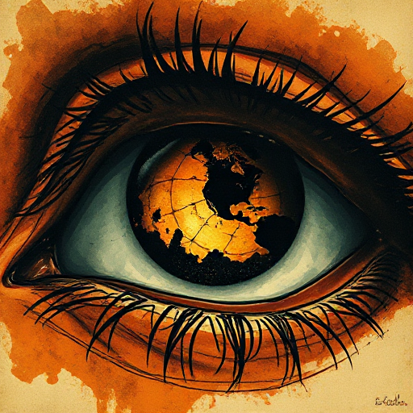

## Tiefer personaler Erzähler

Die Erzählung taucht so tief in das Bewusstsein der Figur ein, dass jeder Satz in ihrer Sprache, Wahrnehmung und emotionalen Realität gefärbt ist. Auch bekannt als Dritte Person limitiert oder Personaler Erzähler. Zwischen Figur und Leser bleibt keine Distanz.

### Funktion

Erzeugt maximale Empathie und Immersion. Jedes beschriebene Objekt sagt etwas über die innere Welt der Figur.

### Anwendung

Erkenne ich in meinem Text noch Formulierungen, die der Autor statt die Figur sagen würde? Wie ersetze ich sie durch die Wahrnehmung meiner Figur?

### Beispiele

- Lyra Silvertongue in His Dark Materials (Pullman)
- Katniss (Die Tribute von Panem)

### Vorsicht

Deep POV mit einer unsympathischen oder uninteressanten Figur kann sehr ermüdend sein.

### Passt zu

- [Ich-Erzähler](ich-erzaehler.md)
- [Bewusstseinsstrom](bewusstseinsstrom.md)
- [Erzähldistanz](erzaehldistanz.md)
- [Neutraler Erzähler](neutraler-erzaehler.md)

### Bild

