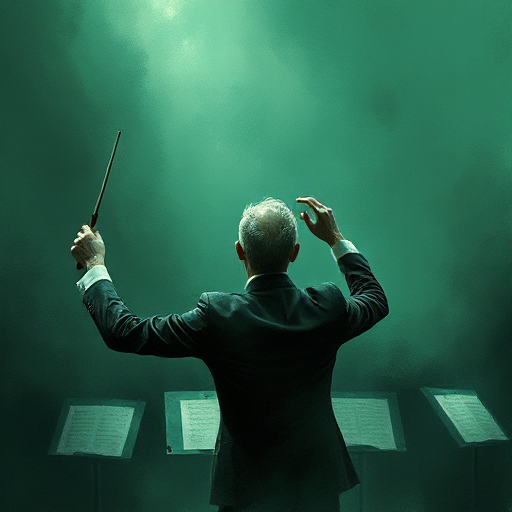

## Ton

Die Haltung des Autors (ausgedrückt durch die Erzählstimme) gegenüber dem Material: ironisch, ernst, humorvoll, distanziert, mitfühlend.

### Funktion

Definiert das Genre-Versprechen und steuert, wie der Leser Ereignisse wertet. Inkonsistenter Ton zerstört die Leser-Immersion.

### Anwendung

Was ist die eine Haltung, die meine Erzählstimme gegenüber der Geschichte einnimmt – und halte ich diese über das gesamte Manuskript?

### Beispiele

- Grimmiger Realismus bei Cormac McCarthy
- zarte Ironie bei Jane Austen
- bitterer Sarkasmus in Catch-22 (Heller)

### Vorsicht

Unkontrollierter Tonwechsel (tragisch zu plötzlich komisch) zerstört die emotionale Kontinuität.

### Passt zu

- [Stimmung](stimmung.md)
- [Figurenstimme](figurenstimme.md)
- [Genre-Konventionen](genre-konventionen.md)

### Bild

