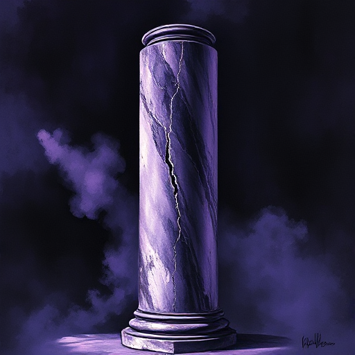

## Tragischer Fehler

Eine grundlegende Charakterschwäche, Blindheit oder Überheblichkeit einer Figur, die unweigerlich zu ihrem Scheitern oder Fall führt.

### Funktion

Macht Tragödie unvermeidlich und erhöht die moralische Tiefe der Geschichte. Der Leser sieht das Scheitern kommen, weil er die Schwäche versteht.

### Anwendung

Was ist die eine Eigenschaft meiner Figur, die sie nicht erkennt oder nicht aufgeben will? Wie wende ich genau diese Eigenschaft gegen sie?

### Beispiele

- Macbeths Ehrgeiz
- Othellos Eifersucht
- Ahabs Obsession (Moby Dick)
- Walter Whites Stolz (Breaking Bad)

### Passt zu

- [Negativer Bogen](negativer-bogen.md)
- [Figur vs. sich selbst](figur-vs-sich-selbst.md)
- [Der Schöpfer](der-schoepfer.md)

### Quellen

- Poetik, Aristoteles

### Bild

