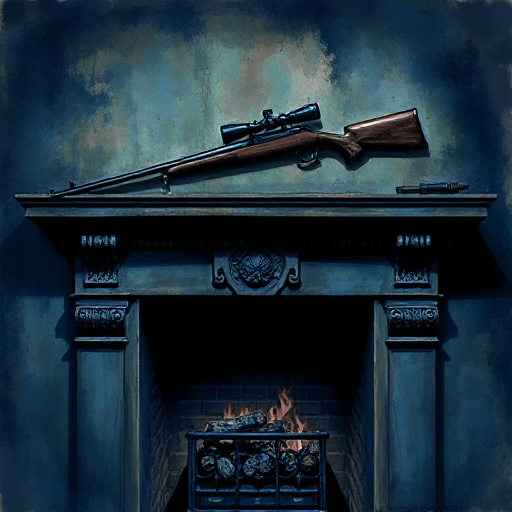

## Tschechows Gewehr

Jedes bedeutsam eingeführte Element einer Geschichte muss irgendwann eine Rolle spielen. Umgekehrt muss alles, was später eine Rolle spielt, zuvor eingeführt worden sein.

### Funktion

Erzeugt ein Gefühl von Dichte und Stimmigkeit: Der Leser spürt, dass die Geschichte durchdacht ist und sich alles zusammenfügt.

### Anwendung

Welche Details in meiner Eröffnungsszene kann ich so platzieren, dass sie im dritten Akt bedeutsam werden, ohne im ersten Moment zu auffällig zu sein?

### Beispiele

- Das Flugblatt zum Blitzeinschlag in den Uhrturm (Back to the Future)
- Hermiones Time-Turner (Harry Potter)
- Das Lichtschwert von Lukes Vater (Star Wars)

### Warnung

Zu offensichtliches Einführen wichtiger Elemente nimmt dem Twist seinen Effekt.

### Passt zu

- [Vorausdeutung (Foreshadowing)](vorausdeutung.md)
- [Der Twist](der-twist.md)

### Quellen

- Anton Tschechow, Brief an Lazarev-Gruzinski (1889)

### Bild

