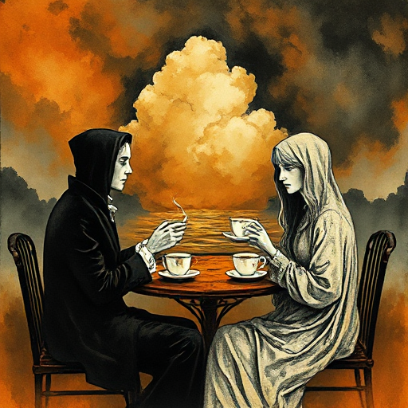

## Unterschwelliger Konflikt

Zwei Figuren sprechen über ein Thema, während sie eigentlich über etwas völlig anderes streiten. Der eigentliche Konflikt liegt unter der sprachlichen Oberfläche.

### Funktion

Gibt Dialog Spannung und emotionale Dichte. Selbst eine scheinbar ruhige Szene kann explosive Intensität haben.

### Anwendung

Was streiten meine Figuren wirklich, wenn sie über das Abendessen, das Wetter oder den Plan streiten?

### Beispiele

- Who's Afraid of Virginia Woolf? (Albee)
- Hills Like White Elephants (Hemingway)

### Passt zu

- [Subtext](subtext.md)
- [Enemies to Lovers](enemies-to-lovers.md)

### Bild

