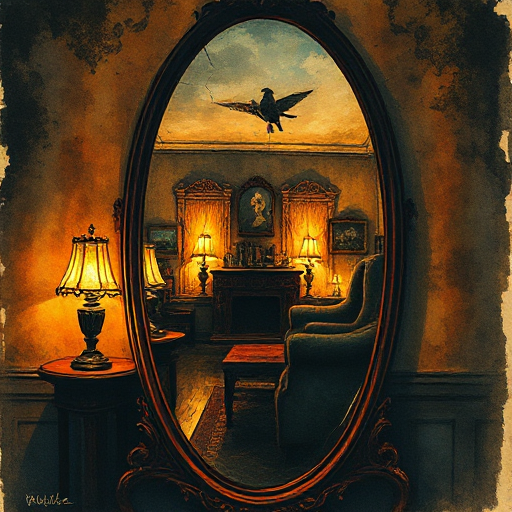

## Unzuverlässiger Erzähler

Ein Erzähler, der dem Leser absichtlich oder unwissentlich ein verzerrtes, unvollständiges oder falsches Bild der Ereignisse vermittelt.

### Funktion

Erzeugt Spannung durch die Frage, was wirklich passiert, und zwingt den Leser zur aktiven Interpretation. Enthüllt Figuren-Psychologie durch Auslassungen.

### Anwendung

Was verschweigt, verdreht oder missversteht mein Erzähler? Welche Szenen zeigen dem aufmerksamen Leser die Risse in seiner Version der Wahrheit?

### Beispiele

- Stevens in The Remains of the Day (Ishiguro)
- Amy Dunne (Gone Girl)
- Humbert Humbert (Lolita – Nabokov)

### Vorsicht

Der unzuverlässige Erzähler funktioniert nur, wenn die Unzuverlässigkeit rückwirkend nachvollziehbar ist.

### Passt zu

- [Der Twist](der-twist.md)
- [Falsche Fährte](falsche-faehrte.md)

### Bild

