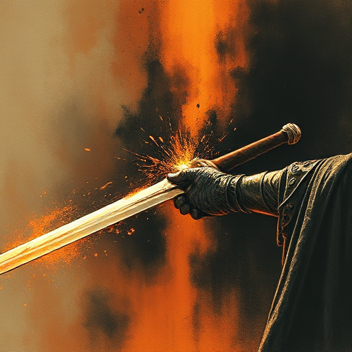

## Verbaler Schlagabtausch (Banter)

Schneller, witziger Wortwechsel, in dem Figuren sich gegenseitig herausfordern und so ihre Beziehung und Chemie zeigen, statt sie zu benennen.

### Funktion

Erzeugt Sympathie, Pausen im Drama und lässt Figurenbeziehungen lebendig und real erscheinen.

### Anwendung

Wie sprechen meine Figuren miteinander, wenn gerade nichts auf dem Spiel steht? Was verrät dieser Ton über ihre Beziehung?

### Beispiele

- Sherlock Holmes & Watson
- Han Solo & Leia (Star Wars)
- Beatrice & Benedick (Much Ado About Nothing)
- Lorelai & Rory (Gilmore Girls)

### Warnung

Banter in Momenten hoher Spannung kann die Fallhöhe untergraben. Wer im Ernst witzelt, signalisiert, dass nichts auf dem Spiel steht.

### Passt zu

- [Ruhepause](ruhepause.md)
- [Figur vs. Figur](figur-vs-figur.md)
- [Figurenstimme](figurenstimme.md)
- [Enemies to Lovers](enemies-to-lovers.md)
- [Subtext](subtext.md)

### Bild

