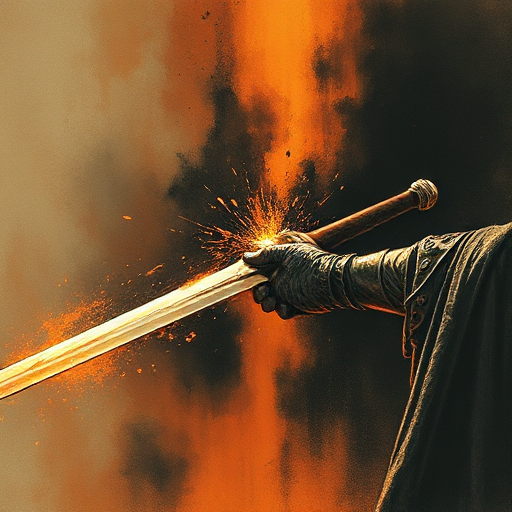

## Verbaler Schlagabtausch (Banter)

Schneller, witziger, oft spielerischer Wortaustausch zwischen Figuren, der Beziehung und Chemie zeigt, ohne Plot zu bewegen.

### Funktion

Erzeugt Sympathie, Pausen im Drama und lässt Figurenbeziehungen lebendig und real erscheinen.

### Anwendung

Wie sprechen meine zwei engsten Verbündeten miteinander, wenn die Welt nicht untergeht? Verrät mir dieser Ton etwas über ihre echte Beziehung?

### Beispiele

- Sherlock Holmes & Watson
- Han Solo & Leia (Star Wars)
- Benedick & Beatrice (Much Ado About Nothing)
- Lorelai & Rory (Gilmore Girls)

### Warnung

Banter, der Plot-relevante Szenen ersetzt statt ergänzt, verlangsamt das Pacing.

### Passt zu

- [Ruhepause](ruhepause.md)
- [Figur vs. Figur](figur-vs-figur.md)

### Bild

