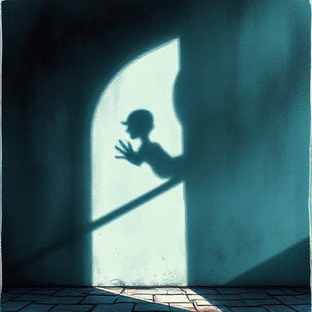

## Vorausdeutung (Foreshadowing)

Subtile Hinweise, Symbole oder Szenen früh in der Geschichte, die spätere Ereignisse vorbereiten, ohne sie zu verraten.

### Funktion

Erzeugt rückwirkend das Gefühl narrativer Unvermeidlichkeit. Belohnt erneutes Lesen.

### Anwendung

Welches Detail in meiner Eröffnung kann ich so platzieren, dass es beim zweiten Lesen deutlich auf das Ende verweist?

### Beispiele

- Die roten Rosen in American Beauty
- die Schneekugel in Citizen Kane
- Tschechows Gewehr in unzähligen Krimis

### Warnung

Zu offensichtliches Foreshadowing nimmt dem Twist den Effekt, zu subtiles bemerkt niemand.

### Passt zu

- [Tschechows Gewehr](tschechows-gewehr.md)
- [Der Twist](der-twist.md)

### Bild

