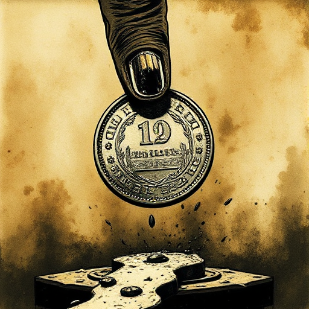

## Wendepunkt der Szene

Der Moment in einer Szene, in dem sich das, was für die Figur auf dem Spiel steht, spürbar verändert: von Hoffnung zu Verzweiflung, von Sicherheit zu Gefahr, von schlimm zu noch schlimmer.

### Funktion

Definiert die dramatische Funktion der Szene. Ohne Turn ist die Szene kein Drama, sondern Beschreibung.

### Anwendung

Welcher konkrete Moment in dieser Szene verändert die Lage meiner Figur? Ist diese Veränderung überraschend genug, um die Szene lohnenswert zu machen?

### Beispiele

- Das erste Verhör in einem Krimi
- das Geständnis in einer Liebesszene
- die Enthüllung in einem Dialog

### Passt zu

- [Szenenziel & Hindernisse](szenenziel-hindernisse.md)
- [Cliffhanger](cliffhanger.md)
- [Enthüllung](enthuellung.md)

### Quellen

- Story, Robert McKee

### Bild

