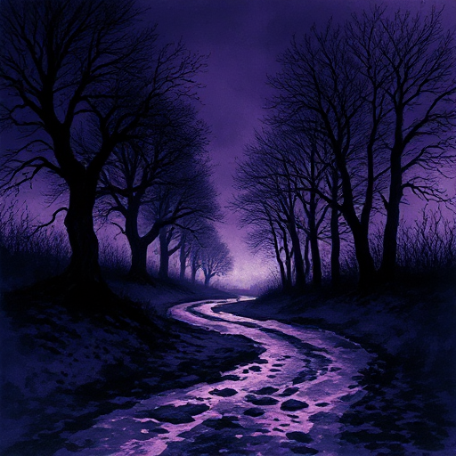

## Wunsch vs. Bedürfnis

Was eine Figur bewusst anstrebt (Wunsch, auch: Motivation), ist selten das, was sie für ihre Entwicklung wirklich braucht (Bedürfnis). Die Geschichte führt sie vom Wunsch zum Bedürfnis.

### Funktion

Erzeugt inneren Konflikt und gibt der Handlung eine doppelte Erzählebene: die äußere Reise zum Wunsch, die innere Reise zum Bedürfnis.

### Anwendung

Was will meine Figur, und was braucht sie wirklich? Wann begreift sie den Unterschied?

### Beispiele

- Simba will vergessen, braucht aber Verantwortung (The Lion King)
- Tony Stark will Kontrolle, braucht Vertrauen (Iron Man)

### Passt zu

- [Die Lüge der Figur](die-luege-der-figur.md)
- [Positiver Wandlungsbogen](positiver-wandlungsbogen.md)
- [Einsätze (Stakes)](einsaetze.md)

### Quellen

- Story, Robert McKee

### Bild

