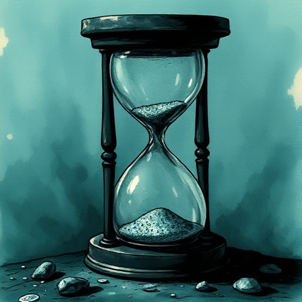

## Zeitdruck

Eine klare Deadline oder ein ablaufendes Zeitfenster, das die Figuren unter Druck setzt und das Scheitern mit einer konkreten, schlimmen Konsequenz verbindet.

### Funktion

Steigert Spannung mechanisch und unerbittlich. Verhindert, dass Figuren sich zu viel Zeit für Überlegungen nehmen.

### Anwendung

Was passiert genau, wenn meine Figur diese Aufgabe nicht rechtzeitig abschließt – und ist diese Konsequenz für den Leser wirklich bedrohlich?

### Beispiele

- Speed (die Bombe im Bus)
- 24 (TV-Serie)
- Arrival (Denis Villeneuve)

### Vorsicht

Der Zeitdruck verliert seine Kraft, wenn er mehrfach verlängert wird ohne echte Konsequenz.

### Passt zu

- [Cliffhanger](cliffhanger.md)
- [Midpoint-Reversal](midpoint-reversal.md)

### Bild

